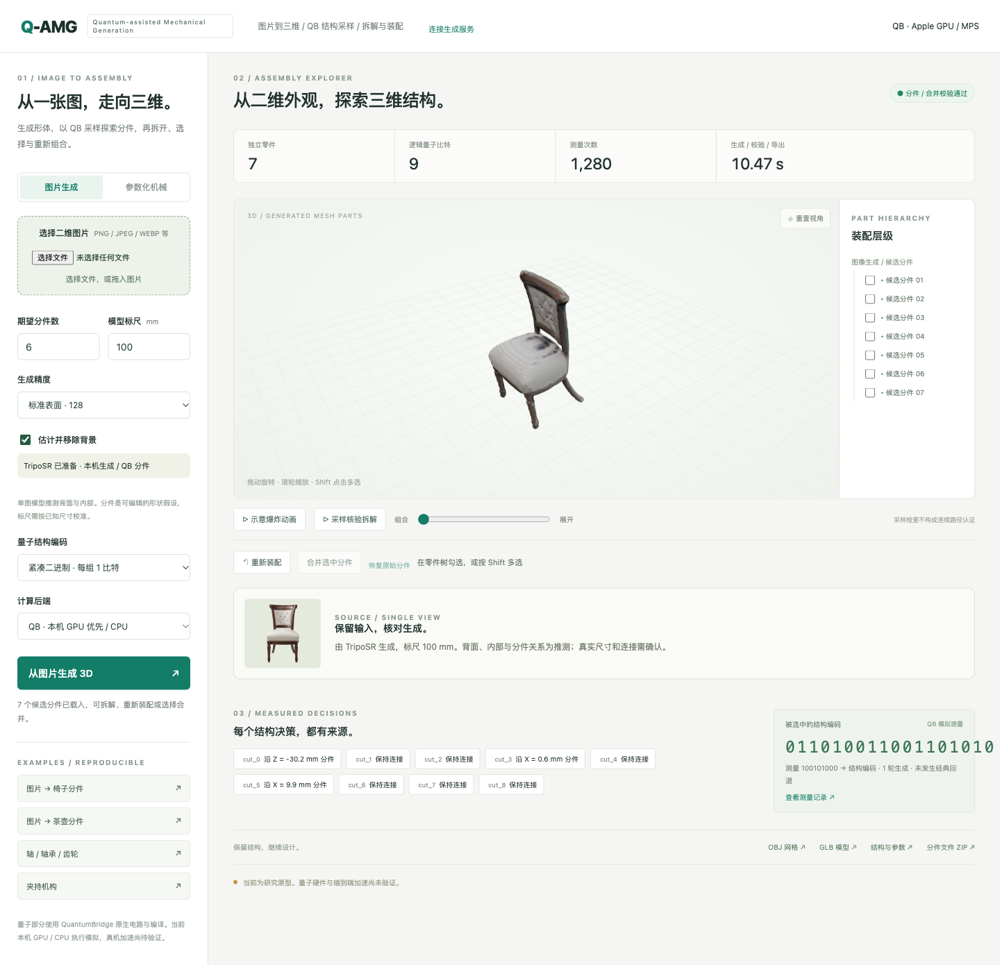

# Q-AMG · Quantum-assisted Mechanical Generation

量子辅助机械生成、拆解与装配系统。量子部分使用公司开源的 [QuantumBridge](https://github.com/crystal-tensor/QuantumBridge) 原生 SDK。

[在线演示](https://crystal-tensor.github.io/Q-AMG/) · [架构与算法](docs/architecture.md) · [本版验收](docs/qb-image-delivery.md) · [超导接入](docs/company-protocol.md)

支持上传二维图片，生成带颜色的三维网格，再由 QB 电路采样决定候选分件，进行封闭切分、拆解展示、选件合并与恢复。另保留传动装配和夹持机构两类参数化 CAD，支持 STEP 导出。

图片入口适用于不同物体类别，当前已实际验证椅子、茶壶和机器人。单图的背面、内部、真实尺寸与装配连接没有唯一答案；生成结果和分件属于推测，不能当作制造级逆向工程结果。



## 启动

需要 Python 3.12、uv、Node.js 24、npm 与 curl。依赖使用 `uv.lock` 和 `web/package-lock.json` 锁定。

```bash
./scripts/demo.sh
```

打开 [本机应用](http://127.0.0.1:8765/)。首次启动会下载约 1.68 GB 的 TripoSR 权重及较小的配置/前景模型，支持断点续传并核对 SHA-256。后续推理使用本地文件，上传图片不发送到外部模型 API。

默认优先使用 CUDA 或 Apple Metal GPU；没有受支持 GPU 时使用 CPU。本机已经实跑 MPS GPU 和完整 CPU 图片路径。

只运行参数化机械功能时可跳过图片权重准备：

```bash
QAMG_SKIP_IMAGE_MODEL=1 ./scripts/demo.sh
```

## 图片、拆解与合并

1. 选择 PNG、JPEG、WEBP、BMP 或 TIFF 图片，设置参考标尺与期望分件数。
2. TripoSR 生成三维外观；QB 采样切面组合，形成可追踪的分件决策。
3. 使用示意爆炸动画或离散碰撞采样序列查看拆解。
4. 在零件树勾选、或 Shift 点击多选，执行布尔合并；可以恢复原始分件。
5. 下载 GLB、OBJ、STL、结构 JSON 与分件 ZIP。图片网格没有伪造 STEP 特征历史。

合并验证比较实体并集与原模型的对称差。体积、形状与原始运行记录保留；空间上不相连的组合仍可能包含多个连通实体。离散碰撞采样不是连续路径认证。

命令行入口：

```bash
uv run --locked qamg doctor
uv run --locked qamg image --input /absolute/path/image.png --output artifacts/runs/my-image
uv run --locked qamg image --input /absolute/path/image.png --device cpu --backend qb --resolution 64 --output artifacts/runs/cpu-image
uv run --locked qamg generate --spec examples/drive.json --encoding compact_binary --output artifacts/runs/my-drive
uv run --locked qamg generate --text '重载齿轮装配，轴长110mm，最大齿轮半径15mm' --encoding compact_binary --output artifacts/runs/feedback
```

## QB 与计算后端

- `auto`：QB 原生电路/编译，Torch CUDA/MPS 态演化；无 GPU 使用 QB 原生 CPU。
- `qb`：QuantumBridge StatevectorDevice 与原生采样。
- `qb-noisy`：QuantumBridge DensityMatrixDevice、原生门噪声与读出噪声，明确为参考模拟。
- `company`：QB 编译、序列化后提交显式配置的公司服务，参考协议见接入文档。
- `classical`：同一原问题的显式经典对照。

应用依赖已移除 Qiskit、Aer 和 PennyLane。测试会阻断这些 SDK 的导入，并执行 QB 电路、编译、采样和序列化。第三方 SDK 源码中保留其自身的可选兼容模块；应用不通过这些模块转发量子执行。

QB 与 TripoSR 的版本、许可和适配修改记录于 [vendor/SOURCES.json](vendor/SOURCES.json)。模型权重不放进 Git，下载来源与校验值在 [准备脚本](scripts/prepare_models.py) 和 `models/manifest.json`。

## 测试与复现

```bash
./scripts/test.sh
./scripts/benchmark.sh
uv run --locked python scripts/validate_image_examples.py --output artifacts/my-image-evidence
uv run --locked python scripts/validate_outputs.py --corpus artifacts/benchmarks/registered-v2/corpus.json --output artifacts/my-cad-acceptance --quantum-backend auto
```

实验使用新目录，保留原始记录、失败、源码与依赖。历史实验使用旧 SDK，存档保持原样；不能把旧结果当作 QB 或真实 QPU 的新测量。

本版真实神经图片证据见 `artifacts/image-neural-v2/`、CPU 路径见 `artifacts/image-cpu-v1/`、浏览器上传与合并证据见 `artifacts/ui-image-evidence/`。这些样例不证明任意图片都能准确恢复隐藏工程结构。

## 在线页面

GitHub Pages 发布可旋转、展开、复位、查看测量来源并下载的示例。生成新图片和保存布尔合并使用本机服务，在页面点击“连接生成服务”即可连接已启动的 `http://127.0.0.1:8765`。浏览器可能要求允许访问本机网络。

公开资源由 `scripts/export_gallery.py` 从人工指定的示例目录生成，私有上传目录 `artifacts/runs/` 不进入 Git 或公开站点。GitHub Actions 工作流见 `.github/workflows/pages.yml`。

当前量子输出确实参与分件和层级决策；实际量子加速与公司真机仍未验证。原型可用、模拟实验和真机加速是分别记录的状态。
